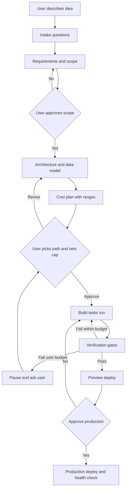
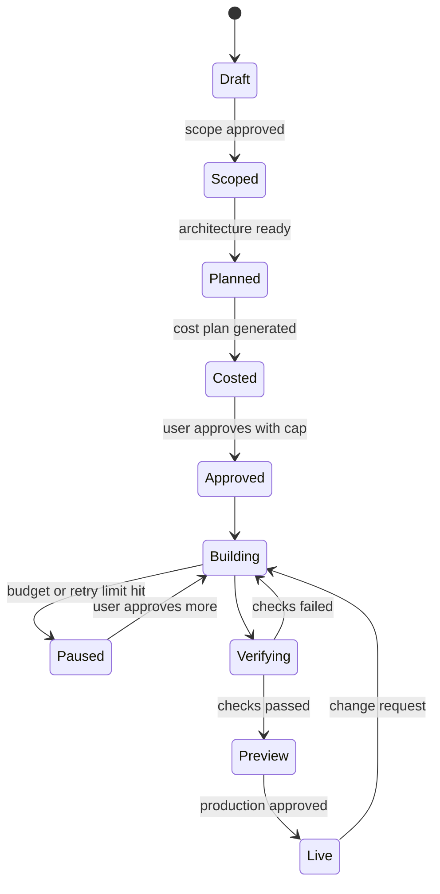
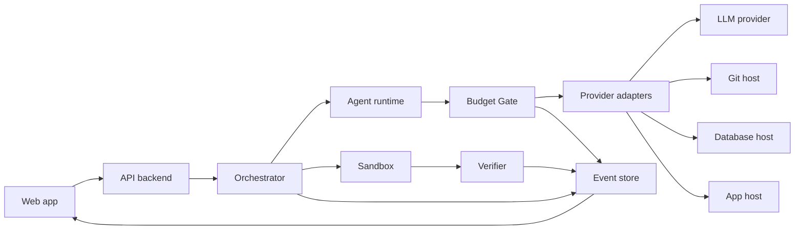

# AI Website Development Orchestrator: Working Model and Requirements

**Document type:** Build plan (working model, requirements, design, MVP sequence)
**Version:** 0.1 draft, 24 Oct 2026
**Source:** Derived from `ai_website_development_orchestration_platform.md`, with the scope narrowed on purpose.
**Status of assumptions:** Items marked **[VERIFY]** depend on provider facts (API availability, free-tier limits, pricing) that must be checked against current official docs before they are relied on or shown to judges.

---

## 0. Decisions this plan makes (and why)

The original spec leaves 12 open questions. A plan cannot stay open on them, so this one picks defaults. Each can be reversed, but each must be reversed deliberately.

| # | Decision | Default chosen | Reason |
|---|----------|----------------|--------|
| D1 | First user | Technical founders and freelancers building small web apps | They tolerate rough edges, repeat projects, and can read a cost plan |
| D2 | Who writes code | Platform drives a coding model through its own build loop; external builders are not in the MVP | External builder APIs are the least certain integration **[VERIFY]** |
| D3 | Stack supported | One: Next.js (TypeScript), Postgres via Supabase, deployed to Vercel | One stack makes cost estimates and verification tractable |
| D4 | Who pays providers | User pays providers directly with their own accounts and API keys (BYO keys). Platform does not resell or rebill in the MVP | Removes margin risk, tax and refund complexity, and the need to hold payment methods |
| D5 | LLM billing | User supplies their own model API key, or uses the platform's capped free quota | Keeps inference cost off the platform in the MVP |
| D6 | Spend control | Platform-side gate before every paid action, plus provider-side limits where they exist **[VERIFY]** | A cap only works if enforced before the charge |
| D7 | Estimates | Always ranges (low, expected, high) with confidence labels, never a single number | LLM agent cost is high-variance |
| D8 | Approval | Human approval required for: any new paid resource, any recurring charge, production deploy, destructive DB operation | Matches the spec's own rules |
| D9 | Hero feature | Pre-build cost plan with ranges (free path vs paid path), plus a budget pause during the build | Research found builders already ship per-message costs, alerts and caps, but no whole-build forecast and no cross-vendor ledger |
| D10 | User-owned accounts | **Required, not optional.** User connects their own host, database and model accounts | No provider API was found for a third party to open an account or attach payment for a user; reselling needs partner status (see section 18) |
| D11 | Free path rules | Gate the free path on **commercial use**, not just quota | Vercel Hobby is non-commercial only and counts a paid consultant as commercial; several free tiers pause or delete projects (see section 18) |
| D12 | Wedge | Pick one before P1: spend governance (Wedge A) or app verification (Wedge B). This plan builds Wedge A first and keeps the verification gates minimal | Evidence supports both better than a generic orchestrator; neither has a demand test yet |

---

## 1. Product definition

**One sentence:** Before an AI builds your web app, it shows what the build and the first months of running it will cost (with a free-tier path), lets you set a hard spending cap, builds and verifies the app, and pauses to ask before any paid action.

**In scope (MVP):** idea intake, requirements, architecture and data model, cost plan with approval, code generation, automated verification, preview and production deploy on the one supported stack, live event feed, budget tracking and enforcement.

**Out of scope (MVP):** multiple stacks, external website builders, design tool integrations, rebilling, team features, ongoing maintenance automation, mobile apps, provider switching mid-project.

**Positioning to avoid:** "all-in-one platform for everything". The pitch is the cost-controlled build, not the lifecycle list.

---

## 2. Working model (end to end)

### 2.1 Flow



### 2.2 The five rules that define the model

1. **One source of truth.** A versioned Project Spec (JSON plus rendered docs). Agents read it and propose changes; they never silently edit it.
2. **Every task is a contract** (inputs, output schema, acceptance check, budget ceiling, timeout, retry limit).
3. **Nothing counts as done without evidence.** Status moves Proposed, Generated, Executed, Verified, Deployed only through system checks, not model claims.
4. **Every paid call passes through the Budget Gate.** No agent holds provider credentials that bypass it.
5. **The feed shows real events.** The UI reads the event table; model text may annotate an event but cannot create one.

### 2.3 Project lifecycle states



---

## 3. System components

| Component | Responsibility | MVP implementation |
|-----------|----------------|--------------------|
| Web app | Chat intake, spec viewer, cost dashboard, approval queue, live feed | Next.js app |
| API backend | Auth, projects, approvals, budget enforcement, event ingestion | Next.js route handlers or FastAPI |
| Orchestrator | Runs the task DAG, retries, timeouts, state transitions | Durable workflow engine (Inngest, Temporal, or a Postgres-backed queue) |
| Agent runtime | Executes tasks by calling the model with a task contract | Role prompts plus one or two models |
| Budget Gate | Reserves and records spend before any paid call; blocks at cap | Service in the API layer, single choke point |
| Pricing Registry | Versioned rates, free-tier limits, source and verification date | Postgres table plus hand-curated seed |
| Estimator | Produces ranged cost plans from spec and registry | Rule-based, calibrated from logged runs |
| Provider adapters | Normalised calls to LLM, Git, DB, host | One adapter per category (4 total) |
| Sandbox | Runs generated code, tests, builds in isolation | Container or hosted sandbox with no production secrets |
| Verifier | Runs the gate checks and records evidence | Test runner plus scanners inside the sandbox |
| Event store | Durable timeline of everything that happened | Append-only Postgres table, streamed by SSE |
| Secrets store | Holds user API keys and tokens | Managed secret store; only the adapter layer can read it |



---

## 4. Functional requirements

Priority: **M** = must (MVP), **S** = should (MVP if time allows), **C** = could (post-MVP).

### 4.1 Intake and requirements

| ID | Requirement | Pri | Acceptance criterion |
|----|-------------|-----|----------------------|
| FR-01 | Accept a free-text idea and ask at most 8 focused follow-up questions covering users, features, data sensitivity, expected traffic, auth, integrations, budget, prototype vs production | M | Questions are asked only for fields that change scope or cost |
| FR-02 | Record every assumption explicitly with a flag the user can correct | M | Spec contains an `assumptions` list; none are hidden |
| FR-03 | Generate product brief, user stories with acceptance criteria, scope exclusions, risk list | M | Each story has a testable acceptance criterion |
| FR-04 | Require scope approval before any build spend | M | Build cannot start in `Draft` or `Scoped` state |

### 4.2 Architecture and data

| ID | Requirement | Pri | Acceptance criterion |
|----|-------------|-----|----------------------|
| FR-05 | Produce architecture on the supported stack with a one-line reason per choice | M | Each component links to the requirement it serves |
| FR-06 | Generate data schema and migrations | M | Migrations apply cleanly to an empty test database |
| FR-07 | Generate API contract (OpenAPI) and page list | M | Contract is validated; frontend tasks depend on it |
| FR-08 | Generate low-fidelity wireframes as structured specs or simple rendered pages | S | Each page maps to a user story |

### 4.3 Cost plan and budget

| ID | Requirement | Pri | Acceptance criterion |
|----|-------------|-----|----------------------|
| FR-09 | Produce a cost plan with line items classified one-time, recurring, usage-based, optional | M | Every line has unit, quantity assumption, rate source, and confidence |
| FR-10 | Show a **free path** and a **paid path** side by side, with the limits and the upgrade cliff of each free choice | M | Plan lists what breaks when a free limit is exceeded |
| FR-11 | Express each uncertain line as low, expected, high | M | Totals shown as ranges over a stated time horizon |
| FR-12 | Let the user set project cap, per-task ceiling, and monthly cap | M | Caps stored in `budgets` and enforced by the Gate |
| FR-13 | Pause the workflow when a cap or approval threshold is reached and explain why | M | No paid call is made after the pause until the user acts |
| FR-14 | Approval request shows reason, blocked task, cost range, alternatives, who bills, cancellability, consequence of declining | M | All fields present on every request |
| FR-15 | Show estimate vs actual per task and per category | M | Dashboard reads from the ledger, not from model text |
| FR-16 | Label every figure as estimated, usage-observed, or invoice-confirmed | M | Label is a stored column |

### 4.4 Build and verification

| ID | Requirement | Pri | Acceptance criterion |
|----|-------------|-----|----------------------|
| FR-17 | Build tasks run as a DAG with declared dependencies | M | Independent tasks run in parallel; dependent tasks wait |
| FR-18 | Generated code runs only in the sandbox with no production secrets | M | Sandbox environment contains no production credentials |
| FR-19 | Gate checks: install, build, type check, lint, unit tests, migration check, dependency vulnerability scan | M | Each check result stored with logs |
| FR-20 | Generate and run end-to-end tests for the main user stories | S | At least one passing browser test per must-have story |
| FR-21 | Retries bounded by count and by cost; on exhaustion stop, keep logs, ask the user | M | Retry limit and cost limit are fields on every task |
| FR-22 | Mark a task Verified only when its required checks passed | M | Status transitions only via the Verifier |

### 4.5 Deployment

| ID | Requirement | Pri | Acceptance criterion |
|----|-------------|-----|----------------------|
| FR-23 | Deploy a preview environment automatically after verification | M | Preview URL and commit hash recorded |
| FR-24 | Production deploy requires explicit user approval | M | Approval row exists before the deploy call |
| FR-25 | Post-deploy health check and recorded deployment version | M | Failed health check blocks the Live state |
| FR-26 | Destructive database operations require explicit approval | M | Gate blocks them otherwise |

### 4.6 Feed, audit, and changes

| ID | Requirement | Pri | Acceptance criterion |
|----|-------------|-----|----------------------|
| FR-27 | Live feed of task, provider call, artifact, test, retry, budget, approval, and deploy events | M | Feed is driven by the event store only |
| FR-28 | Audit log of approvals and deployments | M | Immutable rows with actor and timestamp |
| FR-29 | Natural-language change request that updates the spec, shows affected components and incremental cost, then re-runs checks | S | Change creates a new spec version |
| FR-30 | Export the full project (repo, spec, schema) so the user can leave | S | Export contains everything needed to run elsewhere |

---

## 5. Non-functional requirements

| ID | Category | Requirement |
|----|----------|-------------|
| NFR-01 | Security | Tenant isolation: one user cannot read another's projects, keys, or events |
| NFR-02 | Security | Provider credentials stored only in the secret store; never in prompts, logs, or ordinary tables |
| NFR-03 | Security | Generated code runs with network and resource limits and a timeout |
| NFR-04 | Security | Tool outputs, repo files, and fetched pages are treated as data; instructions inside them are not followed (prompt-injection defence) |
| NFR-05 | Reliability | Workflow state survives crashes and restarts; a task can resume from its last checkpoint |
| NFR-06 | Integrity | Cost and status figures come only from system records |
| NFR-07 | Budget safety | A cap breach by in-flight work must be bounded and disclosed (see section 7.4) |
| NFR-08 | Transparency | Every model call logs provider, model, token counts, cost, and task id |
| NFR-09 | Performance | Feed latency under 2 seconds from event to screen |
| NFR-10 | Portability | Spec and artifacts exportable as plain files |
| NFR-11 | Privacy | Data retention and deletion policy stated; user can delete a project and its artifacts |
| NFR-12 | Usability | A first-time user reaches an approved cost plan in under 15 minutes |

---

## 6. Agent roles and task contract

### 6.1 Roles (logical, not separate models)

| Role | Output |
|------|--------|
| Intake and requirements | Questions, brief, stories, acceptance criteria |
| Architect and data modeller | Architecture, schema, API contract |
| Cost planner | Cost plan with ranges (uses the Estimator, not guesses) |
| Builder (frontend and backend) | Code files, migrations |
| Tester | Unit and E2E tests |
| Reviewer | Security and quality findings |
| Deployer | Deployment actions (only through approved adapter calls) |

Start with **one strong model for most roles**. Add model routing only after logs show a cheaper model passes the same checks. Multi-agent coordination adds failure modes and cost; use it only where parallel work clearly pays off.

### 6.2 Task contract (stored per task)

```json
{
  "task_id": "t_0042",
  "objective": "Implement POST /items endpoint",
  "inputs": {"spec_version": 7, "contract_ref": "api.yaml@v7"},
  "output_schema": "files_changed[]",
  "acceptance": ["unit tests for /items pass", "type check passes"],
  "budget_ceiling_usd": 0.60,
  "retry_limit": 3,
  "timeout_s": 600,
  "depends_on": ["t_0039", "t_0040"],
  "permissions": ["sandbox.write", "git.commit"],
  "verification": "run_checks(unit,types)"
}
```

---

## 7. Cost and budget engine

### 7.1 Three separate ledgers (never merged)

1. **Customer expenditure:** what the user pays providers and any platform fee. This is what the MVP shows.
2. **Platform delivery cost:** what the platform spends (sandbox compute, storage, any subsidised model calls).
3. **Platform profitability:** revenue minus attributable delivery cost. Internal only.

In the MVP (D4, D5) ledger 1 is mostly the user's own provider bills, and ledger 2 is small. Keeping them separate from day one avoids a painful rewrite when rebilling is added.

### 7.2 Estimate formula

```
Plan total (horizon H) = one_time + sum(recurring * months in H) + usage_forecast(low, expected, high) + contingency
```

- Horizon is always stated (build only, first month, first 12 months).
- Contingency for build cost is derived from observed retry rates, not a fixed percentage chosen by feel.

### 7.3 Estimation method (how numbers are produced)

1. **Fixed items** (domain, plan minimums): exact, from the registry.
2. **Build-cost (LLM) items:** reference-class forecasting. Log real runs per feature type (CRUD endpoint, auth, form page, migration). Estimate = historical median tokens per feature type times the model price, with low and high from the 25th and 90th percentiles. Until enough runs exist, widen the range and mark confidence Low.
3. **Operating-cost items:** map expected users and requests from intake to provider billing units; compute against free-tier limits and overage rates.
4. **Always show** the assumptions that drive the number so the user can change them.
5. **Recalculate** after every spec change and after each build phase using actuals.

Honest limit: the first estimates will be rough. The product claim is "transparent ranges that improve", not "accurate prediction".

### 7.4 Budget Gate algorithm

For every paid call (model call, provider action):

1. Compute a **worst-case cost** for the call (for a model call: max input plus max output tokens at the model price).
2. Check `spent + reserved + worst_case <= min(task_ceiling, project_cap, monthly_cap)`.
3. If it passes: write a **reservation**, make the call, then replace the reservation with the **observed cost** from the response usage fields.
4. If it fails: do not call; emit `budget_blocked`, set the task to Paused, create an approval request.
5. Recurring subscriptions and any new paid resource always need explicit approval, regardless of remaining budget.

**Known limits to disclose to the user:**
- Concurrent calls can each pass the check; keep reservations in a transaction or serialise paid calls per project.
- Provider billing data can lag, so observed cost from usage fields is "usage-observed", not "invoice-confirmed".
- The Gate controls only calls routed through the platform. Provider-side limits should be set as a second line of defence where they exist, and the user is told where they do not.
- Worst-case overshoot is roughly (concurrent in-flight requests) x (maximum cost per request). This bound is a derivation from research, not a vendor figure. Serialise paid calls per project to shrink it.
- Spend at a third-party host after deployment is outside the Gate's control. Say so in the cost plan.
- **Pause, do not kill.** Hitting a cap pauses the task with its context saved and offers resume, raise cap, or stop. A hard kill mid-task loses context and wastes the money already spent.
- Write the ledger entry and an idempotency key **before** any side effect. After an approval pause, a resumed step can run again and repeat a paid call otherwise.

### 7.5 Free-first policy

- Default to free tiers and open-source tools for the free path.
- For every free resource, store its limits (quota, pause rules, commercial-use terms, cold starts) **[VERIFY]** and show the upgrade cliff in the plan.
- Free-first means "no new paid charge without approval", never "guaranteed zero cost".
- Do not automate creation of free-tier accounts on the user's behalf; the user connects their own accounts.

### 7.6 Pricing registry (minimum fields)

`provider, product, plan, region, currency, unit, rate_or_tiers, minimum_charge, included_usage, free_limits, billing_period, source_url, verified_at, confidence, revalidate_after`

Rule: any price older than its `revalidate_after`, or not verified from an official source, is shown as an **assumption** and needs user confirmation before a paid commitment.

---

## 8. Data model (MVP tables)

| Group | Tables |
|-------|--------|
| Core | `users`, `projects`, `project_specs` (versioned), `artifacts`, `artifact_versions` |
| Orchestration | `tasks`, `task_dependencies`, `agent_runs`, `activity_events` (append-only), `approvals` |
| Cost | `provider_products`, `pricing_versions`, `cost_estimates`, `cost_estimate_items`, `usage_events`, `cost_ledger_entries`, `budgets`, `reservations` |
| Delivery | `environments`, `deployments`, `test_runs` |
| Secrets | `secret_refs` (pointers only, never values) |

Principles: immutable ids and timestamps; version specs, estimates, prices, approvals; store currency and unit on every money value; each cost row carries a `basis` of estimated, usage_observed, invoice_confirmed; row-level tenant isolation on every table.

---

## 9. Provider adapter contract

Each adapter implements only what the provider really supports.

```
capabilities() -> list of operations, pricing units, limits, auth type
estimate(operation, params) -> cost range and assumptions
execute(operation, params, budget_token) -> result, usage, observed_cost
```

- `execute` requires a `budget_token` issued by the Gate, so there is no path to a paid call that skips the Gate.
- MVP adapters (4): **LLM**, **Git host**, **database host**, **app host**.
- Before adding any adapter, confirm in official docs that the needed operations are exposed through a supported API and allowed by the terms **[VERIFY]**. Unsupported operations are listed as manual steps for the user, not promised as automation.

---

## 10. Verification gates

| Gate | Checks | Blocks |
|------|--------|--------|
| G1 Spec | Every story has an acceptance criterion; schema and contract validate | Build start |
| G2 Task | Task-level acceptance tests pass | Marking the task Verified |
| G3 Integration | Install, build, type check, lint, migrations on a clean database, unit tests | Preview deploy |
| G4 Preview | E2E tests for must-have stories, dependency vulnerability scan, no secrets in repo, **database access-rule (row-level security) check, negative authorisation tests (user A cannot read user B), exposed-key scan** | Production approval |
| G5 Production | Health check after deploy | Live state |

Be honest in the UI about what verification covers. Passing generated tests shows the app matches the tests the platform also wrote; it does not prove the product is correct or secure. Show coverage and scan results rather than a single green badge.

---

## 11. Security model

- Secrets: stored encrypted, readable only by the adapter layer; never passed to a model.
- Sandbox: no production credentials, restricted network, CPU and memory limits, timeouts.
- Prompt injection: content from repos, web pages, and tool outputs is data; actions are taken only per the task contract.
- Least privilege: OAuth scopes limited to what the supported operations need.
- Destructive actions and production deploys: explicit approval, recorded.
- Tenant isolation and audit logging as in NFR-01 and FR-28.

---

## 12. Technology choices (MVP)

| Area | Choice | Note |
|------|--------|------|
| Frontend | Next.js, TypeScript | Same stack the platform generates, so one skill set |
| Backend | Next.js route handlers, or FastAPI | Pick the one you ship fastest in |
| Database | Postgres (Supabase or Neon) | Event table and ledger live here |
| Workflow | Inngest or Temporal, or a simple Postgres queue to start | Avoid heavy infrastructure before it is needed |
| Live updates | Server-sent events | Simpler than WebSockets for a one-way feed |
| Sandbox | Container or hosted sandbox service **[VERIFY]** | Needs isolation and per-run limits |
| Model | One strong coding model first | Add routing after logs justify it |
| Secrets | Managed secret store or encrypted column with KMS | Never plain text |

---

## 13. Build sequence and exit criteria

Sized for a small team or a solo student. Adjust to your real hours; the order matters more than the dates.

| Phase | Build | Exit criterion |
|-------|-------|----------------|
| P0 Validate (1 week) | Interview 8 to 10 target users; map one real app by hand (for example an inventory tool) | At least 3 users say they would use a cost-planned build and state what they pay for tools today |
| P1 Spec and cost plan (2 to 3 weeks) | Intake, requirements, architecture, schema, contract, Estimator, registry seed, approval screen | A user gets a ranged free-vs-paid cost plan for a real idea and can approve it |
| P2 Build and verify (3 to 4 weeks) | Orchestrator, sandbox, build loop, gates G1 to G4, event feed, Git and preview deploy | One realistic app goes from approved plan to verified preview with a full event trail |
| P3 Budget enforcement (2 weeks) | Budget Gate, reservations, pause and approval, estimate vs actual dashboard | A forced overrun pauses the build and cannot proceed without approval |
| P4 Production and hardening (2 weeks) | Production deploy with approval, health checks, change requests, export, security review | Three different apps complete end to end; estimate error recorded |
| P5 Expand (later) | More providers or stacks, routing, rebilling, teams | Only after P4 data shows demand and reliable estimates |

**Rule:** do not start P5 work until P4's recorded estimate-vs-actual error is known. The cost engine's credibility is the product.

---

## 14. Success metrics

| Area | Metric | Target to aim for |
|------|--------|-------------------|
| Delivery | First-pass build success rate | Track; improve each phase |
| Delivery | Acceptance criteria verified | 100% for must-have stories before preview |
| Cost accuracy | Actual build cost within the estimated range | Majority of projects (set the target after the first 10 runs) |
| Control | Unapproved paid calls made | 0 |
| Control | Cap overshoot due to in-flight calls | Measured and disclosed |
| Efficiency | Idea to verified preview | Track median |
| Business | Users who pay or commit after a demo | The real validation signal |

---

## 15. Risks and what to do about them

| Risk | Impact | Response in this plan |
|------|--------|-----------------------|
| Build cost far above estimate | Trust loss | Ranges, per-task ceilings, retry cost limits, pause |
| Provider has no API for needed action | Feature cannot be automated | Capability check first; manual-step fallback |
| Free tier changes or restricts use | Broken free path | Registry with revalidation dates; show cliffs |
| Generated app has security flaws | User harm | Sandbox, scans, honest verification report, production approval |
| Incumbents add budget controls | Differentiator shrinks | Compete on the spec plus verified-plan plus cost loop; validate demand early (P0) |
| Scope creep back to "everything" | Nothing ships | Section 1 out-of-scope list; P5 gate |
| LLM cost eats margin if platform pays | Unit economics | D4 and D5: user pays in the MVP |

---

## 16. Hackathon or pitch demo (5 minutes)

1. Type an idea ("inventory tracker for a small shop").
2. Show intake plus explicit assumptions.
3. Show the **cost plan**: free path vs paid path, ranges, upgrade cliffs.
4. Set a low cap and approve.
5. Show the live feed while the build runs.
6. **Force an overrun** so the Budget Gate pauses and shows the approval request.
7. Approve, show verification gates passing, open the preview.
8. Show estimate vs actual.

Steps 3 and 6 are the pitch. Everything else is supporting evidence that the system really builds.

---

## 17. Open items to resolve before building

1. ~~Competitor check~~ Done: no whole-build forecast or cross-vendor ledger found, but "not found" is not proof. Re-check Product Hunt, GitHub and startup directories for small entrants before you claim novelty.
2. Confirm official API support and terms for the chosen LLM, Git, database, and host adapters **[VERIFY]**. Vercel, Supabase, Neon and Cloudflare can create resources in an existing account; the Supabase OAuth flow and reseller terms were not fully read.
3. Re-read the current free-tier limits and commercial-use terms for the exact host and database you pick **[VERIFY]**; they change often.
4. Choose the sandbox technology and check its cost per build **[VERIFY]**.
5. Decide who your first 10 interviewees are and how you will reach them.
6. Decide the platform's own pricing only after P4 data exists.

---

## 18. What the research changed in this plan

Full evidence and source links are in `AI orchestrator platform critique.md`. Evidence strength varies; "unverified" items from the research are not repeated here as facts.

| Finding | Change made |
|---------|-------------|
| Builders (Lovable, Replit, Copilot) already show per-message cost, alerts and caps; none found forecasts a whole build or keeps one ledger across vendors | D9 reworded: the hero is the **pre-build cross-vendor forecast with ranges**, not "cost control" in general |
| GitHub Spec Kit, Kiro and BMAD already provide persistent specs | Do not pitch the spec as the differentiator. Consider building on Spec Kit's extension system and adding only budget, approval and reconciliation fields |
| No gateway documents a true zero-overshoot hard cap; the best case is reserve-then-settle | Gate algorithm kept, limits and overshoot bound added to section 7.4; the promise is "no unapproved paid provisioning, and bounded LLM spend", not "no charge ever exceeds the cap" |
| Gateway budgets only see LLM traffic | Hosting, domains and subscriptions need a **separate approval and commit ledger** (discrete purchases are easier than metered ones and are worth building) |
| One rigorous study found 161% median cold-start error predicting agent token cost, falling to 36% after one cheap probe run (small sample, one model) | Estimator: run a cheap probe before quoting, label every line as exact, conditional, empirical or unpriced, publish calibration, wide ranges until about 10 comparable runs exist, never use the model's own self-estimate |
| Agent token cost for identical tasks varied by up to 30x in one study | Per-task ceilings and pause-and-resume are mandatory, not optional |
| No provider API found for a third party to open accounts with payment | D10: user-owned accounts required |
| Vercel Hobby is non-commercial and counts consultant-written code as commercial; Supabase free pauses idle projects; Render free Postgres expires | D11 and FR-10: show a commercial-use warning and the pause or expiry behaviour on every free option. A freelancer's client project starts on a paid plan |
| Builder APIs are uneven (Lovable has no create-and-prompt API, Base44 is beta, Replit and Bolt unconfirmed) | External builders stay out of the MVP (D2) |
| About half of backends that passed functional tests were still exploitable in one benchmark; real failures are mostly access-control and exposed-secret flaws | G4 expanded; "Verified" is shown as a checklist of what passed and what was not tested, and the UI states who wrote the tests |
| Multi-agent evidence favours few agents plus deterministic gates; parallelism helps only on independent tasks | Section 6 default of one strong agent kept; use parallel agents only for independent work such as test generation, scans and docs |
| Durable-execution tools (LangGraph, Temporal) are off the shelf | Do not build your own workflow engine; spend the effort on idempotent adapters and the ledger |
| Demand evidence is from enterprise engineering orgs; no data on freelancers or agencies; no product found that succeeded selling cost control as its main feature | P0 is not optional. Ask interviewees to commit to something (a pilot, a deposit), not just say it sounds good |
| Hackathon judging guidance rewards one working path and honesty about gaps | Section 16 demo stays at 5 minutes, with steps 3 (cost plan) and 6 (forced pause) as the core |

**Honest status of the concept:** a hypothesis with a plausible narrow wedge, not a validated product. The strongest ideas in the original spec are its constraints (no model claim as proof, no exact-bill promise, no zero-cost promise), not its feature list.
